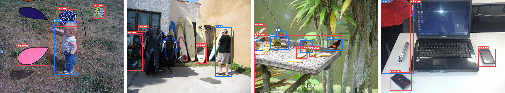
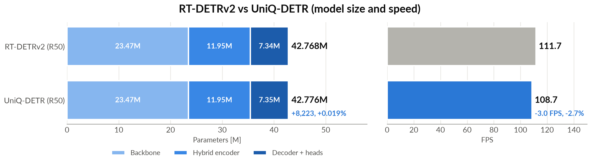
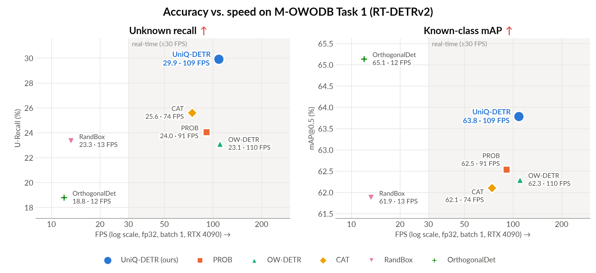

<p align="center">
  
</p>

<p align="center">
  
</p>


## Highlights

This is the official implementation of UniQ-DETR: **Real-Time Open-World Object Detection with Unique Queries for Unknown Objects**

- **NMS Free：** 推論は元の RT-DETRv2 と同じく topk だけです。NMS も重複除去も使いません。
- **Unique Queries：** クラスによらない 1 対 1 ヘッド r を持ちます。r は、物体ごとに代表のクエリを 1 個だけ選ぶように学習するので、未知物体の重複も NMS なしで抑えられます。
- **Self-Supervised Pseudo-Labels：** 学習初期の自分自身を教師にして、未知物体の疑似ラベルを作ります。外部のモデル（SAM など）は使いません。
- **Performance：** M-OWODB Task 1 で **U-Recall 29.92**（Known AP50 63.78）、**約 109 FPS** です（RTX 4090、fp32、バッチ 1）。パラメータ数は元の RT-DETRv2 から +8,223（+0.019%）だけです。U-Recall は、NMS ありの比較手法も含めて最高です（OW-DETR-RT は NMS 0.5 で 27.23）。

<p align="center">
  
  
</p>

## Records

開発中の M-OWODB Task 1 の記録です。推論設定を選ぶための半分割の report 側の値なので、下の Results（テスト全体）とは直接比べられません。推論はすべて topk のみです。詳細は `analysis/G4_PLAN.md` にあります。

| 日付 | 段階 | 変更点 | Known AP50 | U-Recall |
|---|---|---|---:|---:|
| 2026-10-28 | 案 G3 | 1 対 1 ヘッド r ＋ OW-DETR の疑似ラベル（300 クエリ） | 62.61 | 23.92 |
| 2026-11-02 | G4-1 | 疑似ラベルを学習初期の自分自身を教師にしたものに置き換え | 62.17 | 25.99 |
| 2026-11-04 | G4-4 | 600 クエリで学習 | 62.87 | 27.24 |
| 2026-11-05 | G4-4（推論の改良） | 900 クエリで推論、未知スコアに箱の面積の項を追加 | 63.53 | 28.69 |
| 2026-11-06 | G4-6 | r も疑似ラベルの箱で学習、未知スコアの r の指数を 0.5 → 1、900 クエリで推論 | 63.78 | 29.63 |
| 2026-11-08 | **UniQ-DETR**（G4-8） | エンコーダの提案も疑似ラベルの箱で学習、推論は学習と同じ 600 クエリ | **64.16** | **30.76** |

## Results (WIP)

評価の条件：
- 1 画像 top-100 です。
- 値はテスト全体（PROB と同じ評価）です。
- 推論設定（w、NMS の IoU）は、テスト画像を名前の偶奇で 2 分割した片方（tune 側）で選びます。
- 選ぶ基準は、UniQ-DETR が「tune 側の Known AP50 ≥ 63.5 のもとで U-Recall 最大」（w 12）、比較手法が「Known AP50 ≥ 61.51 のもとで U-Recall 最大」です。
- 比較手法は、同じ RT-DETRv2・同じ学習レシピに移植したもの（`-RT`）です。値はそれぞれの最良の後処理でのものです（`analysis/G3_SUMMARY.md`）。

| Method | Post-Pro. | Known AP50 | U-Recall | WI ↓ | A-OSE ↓ | FPS（fp32） |
|---|---|---:|---:|---:|---:|---:|
| **UniQ-DETR** | **topk** | 63.78 | **29.92** | 0.055 | 14,507 | 109 |
| OW-DETR-RT | NMS (0.5) | 61.92 | 27.23 | 0.055 | 14,952 | 96 |
| CAT-RT | NMS (0.7) | 62.11 | 25.60 | 0.058 | 22,840 | 74 |
| PROB-RT | NMS (0.7) | 62.54 | 24.04 | 0.072 | 9,612 | 91 |
| RandBox-RT | NMS (0.5) | 61.88 | 23.34 | 0.036 | 10,823 | 13.2※ |
| OrthogonalDet-RT | NMS (0.5) | **65.13** | 18.79 | **0.028** | **3,891** | 12.0※ |
| OW-DETR-RT | topk | 62.29 | 23.11 | 0.055 | 6,310 | 110 |
| PROB-RT | topk | 61.23 | 20.85 | 0.060 | 4,193 | 112 |
| CAT-RT | topk | 61.79 | 14.56 | 0.049 | 4,300 | 89 |
| RT-DETRv2（閉集合、参考） | topk | — | — | — | — | 112 |

※ RandBox 系は元の推論（格子状の箱 10,000 個、NMS 0.6）での値です。

FPS は全手法を同じ GPU（RTX 4090）で続けて測った、3 回の中央値です（fp32、バッチ 1、640×640、後処理込み、`scripts/run_bench_fps_all.sh`）。

注意点：
- **w の選び方：** UniQ-DETR は Known AP50 を優先して、基準を ≥ 63.5 に上げて w 12 を選んでいます。比較手法と同じ基準（≥ 61.51）で選ぶと w 24 になり、Known 62.63・U-Recall 31.36・A-OSE 5,889 です。
- **面積の項の公平性：** 未知スコアの面積の項を、比較手法にも掛けて確かめました。U-Recall の変化は −0.8〜+1.0pt で、最高が UniQ-DETR であることは変わりません。ただし、OrthogonalDet-RT の Known AP50 は 65.50 に上がります（report 側の値、`analysis/G4_PLAN.md` §6.6）。
- **未達の目標：** Known AP50 は、OrthogonalDet-RT に及びません。

## Methods

### Base model

| Detector | Backbone | States |
|---|---|---|
| RT-DETRv2 | R50 | ✅ (WIP) |
| RT-DETRv2 | R18 | 予定 |
| RT-DETRv2 | R101 | 予定 |
| RT-DETRv4 | R18 | 予定 |
| RT-DETRv4 | R50 | 予定 |
| RT-DETRv4 | R101 | 予定 |
| RF-DETR | Small | 予定 |
| RF-DETR | Medium | 予定 |
| RF-DETR | Large | 予定 |
| DEIMv2 | S | 予定 |
| DEIMv2 | M | 予定 |
| DEIMv2 | L | 予定 |

現在の構成は RT-DETRv2（PResNet-50、640×640、デコーダ 6 層）です。そこに次の要素を足しています。

### 1. 4 つの軽いヘッド（デコーダの各層、各 Linear(256→1) 程度）

| ヘッド | 意味 | 学習 |
|---|---|---|
| 物体らしさ o | 全クエリの分布からの距離（BatchNorm 後の二乗ノルム、PROB と同じ） | 既知 GT に対応付いたクエリの d² を小さくする |
| 既知以外 u | 既知クラスに対応付かないクエリか | 未マッチのクエリ = 1、対応付いたクエリ = 0（focal） |
| 位置の当てはまり具合 q | 箱が物体にぴったり合っているか（クラス非依存の IoU 予測） | 既知 GT と IoU ≥ 0.3 のクエリだけ、IoU を目標に学習する |
| **1 対 1 ヘッド r** | そのクエリが物体を代表する 1 個か（unique query） | 既知 GT と未知の疑似ラベルの箱に対応付いたクエリ = 1、同じ箱と IoU ≥ 0.5 の他のクエリ = 0、背景は損失なし |

- **r がこの手法の中心です。**
  - DETR の既知クラスが NMS なしで重複しないのは、1 対 1 マッチングのおかげです。
  - r はこの性質をクラスによらない形で学ぶので、未知物体の重複も抑えられます。

### 2. 学習初期の自分自身を教師にした疑似ラベル（学習前にオフラインで一度だけ作る）

- **教師：** 同じ構成の検出器を 2 エポックだけ学習した重みを使います。学習初期のモデルは、未知物体をまだ背景として抑え込んでいないためです。
- **作り方：**
  1. 学習画像ごとに、教師の予測を元画像と左右反転画像で得ます。
  2. 既知 GT と重ならない箱を候補にします。
  3. 反転一致度（反転画像の予測との最大 IoU）で順位を付け、上位 5 個を unknown の疑似ラベルにします。
- **学習での使い方：**
  - 疑似ラベル 1 個につき、最も重なる未マッチのクエリ 1 個を unknown クラスの正例にします。使い始めるのはエポック 9 からです。
  - 1 対 1 ヘッド r も、疑似ラベルの箱で学習します（`OWCriterion.pseudo_primary`）。r が既知 GT だけで学習されていると、未知物体を覆うクエリの r が低くなり、取りこぼしの主な原因になっていました（取りこぼしの最良クエリの σ(r) 中央値 0.08 → 0.15）。
  - エンコーダの提案（クエリの選択に使うスコアと箱）も、疑似ラベルの箱を unknown として学習します（`OWCriterion.enc_pseudo`）。既知 GT だけで学習すると、未知物体の提案があってもクエリに選ばれませんでした。

### 3. 600 クエリ

- クエリを増やすと、未知物体を覆う候補が増えます。デコーダ候補の網羅率は、300 クエリの 47% から、600 クエリでは 59% になります（G4-6）。重複は r が抑えるので、topk のままでも U-Recall が上がります。
- エンコーダも疑似ラベルで学習すると、未知物体の提案がクエリに選ばれるようになります（900 クエリで、選ばれた提案が覆う中くらいの未知物体 65.0% → 72.8%、大きい未知物体 87.3% → 95.0%）。
- そのため、推論でクエリを増やす必要がなくなりました。学習と同じ 600 クエリの方が 900 クエリより良い結果です（report 側の U-Recall 30.76 / 29.89）。

### 4. 推論のスコア

- **既知の 20 列：** p(c)
- **未知の 1 列：** w · o · σ(u) · q · σ(r) · (箱の面積)^0.25
  - 面積は 0〜1 に正規化した値で、w = 12 です。
- スコア行列 [600 × 21] 全体から、上位 100 件を出力します。
- 追加の計算は、要素ごとの積だけです。

面積の項は、r で重複を抑えた後に残る誤検出（小さな背景の断片）を押し下げます。G4-6 では、この項で U-Recall が 28.62 から 30.48 に上がりました（tune 側の基準どおりに w を選んだ場合）。

## Getting Started

### Installation

```bash
git clone --recursive https://github.com/usagisukisuki/UniQ-DETR.git
cd UniQ-DETR
# clone 済みなら: git submodule update --init
uv sync          # .venv（Python 3.11, torch 2.8.0+cu128）
```

サブモジュール（`third_party/`）：

| パス | リポジトリ | コミット | 用途 |
|---|---|---|---|
| `third_party/RT-DETR` | [lyuwenyu/RT-DETR](https://github.com/lyuwenyu/RT-DETR) | `df2a96c` | 検出器の本体。無改変で使い、拡張はすべて `owod/` のサブクラス |
| `third_party/PROB` | [orrzohar/PROB](https://github.com/orrzohar/PROB) | `b1d7fe6` | M-OWODB の分割ファイル（`data/OWOD/ImageSets/TOWOD`）と、評価器の照合 |

- バックボーンは、ImageNet 事前学習の重みだけを使います。COCO 事前学習の RT-DETR 重みは、未知クラスを見ているので使いません。

### Data

M-OWODB（Task 1）は、PASCAL VOC と COCO から作ります。画像は次の 3 つをダウンロードして、任意の場所に置いてください。

| データ | ダウンロード | 使う部分 |
|---|---|---|
| PASCAL VOC 2007 / 2012 | [VOCtrainval_06-Nov-2007.tar](http://host.robots.ox.ac.uk/pascal/VOC/voc2007/VOCtrainval_06-Nov-2007.tar)、[VOCtest_06-Nov-2007.tar](http://host.robots.ox.ac.uk/pascal/VOC/voc2007/VOCtest_06-Nov-2007.tar)、[VOCtrainval_11-May-2012.tar](http://host.robots.ox.ac.uk/pascal/VOC/voc2012/VOCtrainval_11-May-2012.tar) | 学習（既知 20 クラス）とテストの VOC 部分 |
| COCO 2017 val | [val2017.zip](http://images.cocodataset.org/zips/val2017.zip)、[annotations_trainval2017.zip](http://images.cocodataset.org/annotations/annotations_trainval2017.zip) | テストの COCO 部分（未知クラスを含む） |

```bash
# VOC 2007 test の XML（difficult フラグ）-> data/raw/voc07test/VOCdevkit/VOC2007/Annotations
mkdir -p data/raw/voc07test && tar -xf VOCtest_06-Nov-2007.tar -C data/raw/voc07test

# M-OWODB の注釈 -> data/mowodb/{t1_train,test}.json（画像は JSON 内の絶対パスで参照）
uv run python -m scripts.prepare_mowodb \
    --voc-img-dir <VOC の JPEGImages（2007 と 2012 をまとめたもの）> \
    --voc-train-json <VOC 2007+2012 trainval の COCO 形式 JSON> \
    --coco-val-json <COCO>/annotations/instances_val2017.json \
    --coco-val-dir <COCO>/val2017
```

- 分割（どの画像を学習・テストに使うか）は、PROB の `TOWOD` の分割ファイルに従います。
- `t1_train.json` は 16,551 枚・既知 20 クラスのみです。`test.json` は 10,246 枚（VOC07 test 4,952 + COCO val2017 5,294）で、未知 GT は 23,320 個です。
- `--voc-train-json` には、VOC 2007+2012 trainval の注釈を COCO 形式（カテゴリ名は VOC のクラス名）にまとめた JSON を渡します。
- 学習データに未知クラスの正解が混ざらないように、`OWODDetection(split='train')` が読み込み時に検査します（`owod/data/mowodb.py`）。

### Baselines（任意）

比較手法は、元の実装を読んで RT-DETRv2 に移植しています（`configs/baselines/`、`owod/`）。元のリポジトリは実行には不要で、移植の参照用です。
読む場合は `third_party/baselines_src/` に clone してください（git の管理外）。

```bash
mkdir -p third_party/baselines_src && cd third_party/baselines_src
git clone https://github.com/akshitac8/OW-DETR.git        && git -C OW-DETR checkout 3515ff8
git clone https://github.com/scuwyh2000/RandBox.git       && git -C RandBox checkout 9b1f7d8
git clone https://github.com/feifeiobama/OrthogonalDet.git && git -C OrthogonalDet checkout d36b8e5
git clone https://github.com/xiaomabufei/SKDF.git          && git -C SKDF checkout c78c3b5
```

| 手法 | 元のリポジトリ | 移植先の設定 |
|---|---|---|
| OW-DETR | [akshitac8/OW-DETR](https://github.com/akshitac8/OW-DETR) | `configs/baselines/owdetr_rt.yml` |
| PROB | [orrzohar/PROB](https://github.com/orrzohar/PROB)（サブモジュール） | `configs/b_prob_rt.yml` |
| CAT | [xiaomabufei/SKDF](https://github.com/xiaomabufei/SKDF)（同じ著者のコード。カスケード復号と選択的探索はこれに従い、疑似ラベルは CAT の論文の式で実装） | `configs/baselines/cat_rt.yml` |
| RandBox | [scuwyh2000/RandBox](https://github.com/scuwyh2000/RandBox) | `configs/baselines/randbox_rt.yml` |
| OrthogonalDet | [feifeiobama/OrthogonalDet](https://github.com/feifeiobama/OrthogonalDet) | `configs/baselines/orthogonaldet_rt.yml` |

- 評価器の照合（`tests/test_owod_eval_vs_prob.py`、`tools/prob_check/`）には、PROB の公式 Task 1 の重みを `third_party/prob_download/MOWODB/t1.pth` に置きます。重みは PROB の README のリンクから取得できます。

### Training and Evaluation

GPU は `CUDA_VISIBLE_DEVICES` で指定します。学習は GPU 1 枚で、50 エポックに約 8 時間かかります。

```bash
# 1. データ（M-OWODB Task 1）-> data/mowodb/{t1_train,test}.json（引数は上の Data を参照）
uv run python -m scripts.prepare_mowodb --voc-img-dir ... --voc-train-json ... --coco-val-json ... --coco-val-dir ...

# 2. 疑似ラベルの教師：E2 と同じ構成を 2 エポックだけ学習（outputs/e2_pilot_bn/last.pth）
uv run python tools/train.py -c configs/e2_obj.yml -u epoches=2 --output-dir outputs/e2_pilot_bn

# 3. 疑似ラベル（反転一致度の上位 5 個 / 画像）-> data/pseudo_unk/e2ep2_cons_k5.json
uv run python tools/make_pseudo_unk.py -c configs/e2_obj.yml -r outputs/e2_pilot_bn/last.pth \
    --ann data/mowodb/t1_train.json --out-prefix data/pseudo_unk/e2ep2_cons --ks 5

# 4. 学習（600 クエリ、r とエンコーダも疑似ラベルで学習）-> outputs/g4_8/best.pth
uv run python tools/train.py -c configs/g4_8.yml

# 5. 評価（600 クエリ、w は tune 側で選び、テスト全体の値を表示）
uv run python tools/sweep_pp.py -c configs/uniq_detr.yml -r outputs/g4_8/best.pth --full --grid unk_weight=12,24

# 6. 速度（バッチ 1、モデル＋後処理、fp32 と AMP）
uv run python tools/bench_fps.py -c configs/uniq_detr.yml -r outputs/g4_8/best.pth
```

- `scripts/run_g4_8.sh` は、手順 4 とその後の推論設定の掃引・分析をまとめて行います。
- `-u key=value` で、YAML の設定を上書きできます。
- テスト全体で評価するだけなら、`tools/train.py -c configs/uniq_detr.yml --test-only -r outputs/g4_8/best.pth` です（Results の表と同じ値）。

### Configs

`configs/uniq_detr.yml`（推論）
→ `g4_8.yml`（エンコーダも疑似ラベルで学習）
→ `g4_6.yml`（r も疑似ラベルで学習）
→ `g4_4.yml`（600 クエリ）
→ `g4_1.yml`（疑似ラベル）
→ `m0_primary_owdetr.yml`（r、unknown クラス）
→ `m0_owdetr.yml` → … → `include/rtdetrv2_r50_ow.yml`

| 段階 | 設定 | 内容 |
|---|---|---|
| M₀ | `configs/f1_quality_50ep.yml` | o・u・q のヘッド |
| 案 G | `configs/m0_primary.yml` | + 1 対 1 ヘッド r |
| 案 G3 | `configs/m0_primary_owdetr.yml` | + unknown クラスと OW-DETR の学習信号 |
| G4-1 | `configs/g4_1.yml` | 疑似ラベルを、学習初期の自分自身を教師にしたものに置き換え |
| G4-4 | `configs/g4_4.yml` | 600 クエリで学習 |
| G4-6 | `configs/g4_6.yml` | + r も疑似ラベルの箱で学習 |
| G4-8 | `configs/g4_8.yml` | + エンコーダの提案も疑似ラベルの箱で学習（UniQ-DETR の学習設定） |
| **UniQ-DETR** | `configs/uniq_detr.yml` | G4-8 の重みを 600 クエリで推論、面積の項を含む未知スコア |

## Project Structure

| パス | 中身 |
|---|---|
| `owod/zoo/ow_decoder.py` | デコーダとヘッド（o・u・q・r）、疑似ラベルの DN 除外 |
| `owod/zoo/ow_criterion.py` | 損失（`loss_primary` = r、`_ext_pseudo` = 疑似ラベルの割り当て、`enc_pseudo` = エンコーダへの疑似ラベル） |
| `owod/zoo/ow_postprocessor.py` | 推論のスコア（`unk_score: learned_qr`、`unk_r_gamma`、`unk_q_exp`、`unk_area_exp`）と topk |
| `owod/eval/owod_eval.py` | 評価器。PROB の `open_world_eval.py` の移植で、PROB 公式重みで論文値を再現済み（`docs/EVAL_VALIDATION.md`） |
| `tools/` | 学習、疑似ラベル作成（`make_pseudo_unk.py`）、推論設定の掃引（`sweep_pp.py`）、分析（`diag_unk_*.py`）、速度（`bench_fps.py`） |
| `configs/baselines/` | 比較手法の RT-DETRv2 への移植（OW-DETR、CAT、RandBox、OrthogonalDet）。PROB は `configs/b_prob_rt.yml` |
| `analysis/` | 最新の実験の記録。`G4_PLAN.md` は UniQ-DETR に至る経緯と全結果、`G3_SUMMARY.md` は前段のまとめ |
| `docs/` | それ以前の記録（実装メモ、比較手法の移植、評価器の検証） |
| `figs/` | ロゴなどの図 |

## TODO

- [ ] **Known AP50 の向上：** OrthogonalDet-RT の 65.13 にはまだ届いていません。閉集合でも 64.06 なので、検出器そのものを強くする必要があります。
- [ ] **A-OSE の増加：** G4-8 で A-OSE が 3,656 → 7,200 に増えました（report 側）。原因を調べています（`tools/diag_aose.py`）。
- [ ] **小さい未知物体：** エンコーダの全提案でも 57% しか覆えていません。エンコーダの箱の回帰が課題です（`tools/diag_small_cov.py`）。
- [x] **G4-6：** r の学習に疑似ラベルの箱も入れました（U-Recall 28.69 → 29.63）。
- [x] **疑似ラベルの更新・数：** 更新の模擬（`tools/sim_pseudo_update.py`）と、数を増やした学習（G4-7）では改善しませんでした（`analysis/G4_PLAN.md`）。
